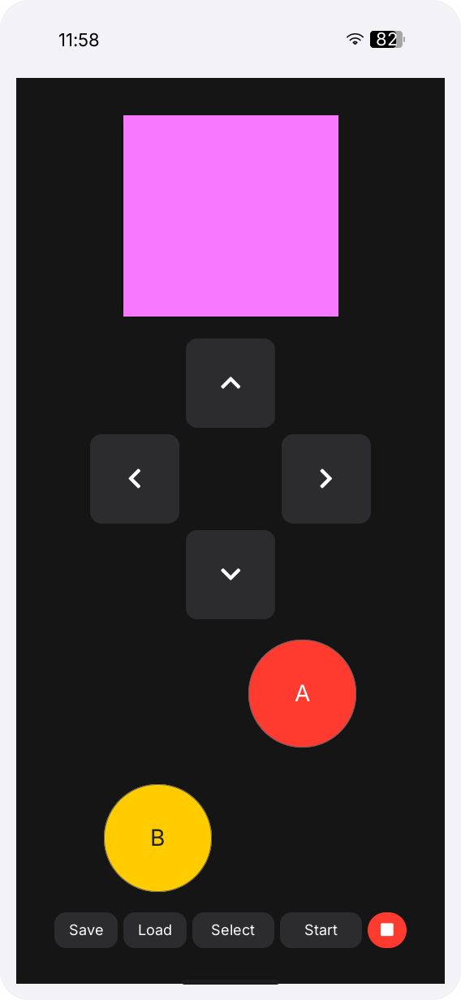

# LILYGO UI NES

**English** | [简体中文](README.zh-CN.md)

LILYGO UI NES is a NES emulator for LILYGO UI, built with C++17,
[LILYGO UI AppKit](https://github.com/LILYGO-UI/cm0-appkit), LVGL 9.5, and
the FCEUmm emulator core. It discovers user-provided `.nes` files and plays
them with on-screen controls and audio.

FCEUmm is the only supported core. The `cm0-cross-gles` preset builds its GLES device
package.
See [FCEUmm Integration](docs/05-fceumm.md) for installation, compatibility
and runtime details.

The project provides a CM0 ARM64 Linux build and an SDL2 desktop simulator
for development and testing. No commercial game ROMs are included; use ROM
images that you are legally entitled to run.

## Preview

<p>
  
</p>

The preview shows the generated NROM test program.

## Features

- **ROM library:** browse and import local ROMs into `$HOME/nes/rom`, inspect iNES
  metadata, refresh the list, and swipe a game card to delete its ROM file.
- **Emulation:** FCEUmm CPU, PPU, APU, and mapper emulation runs in a dedicated
  thread, delivering native `256 x 240` RGB565 frames to LVGL.
- **Save progress:** Save and Load on the game page provide one manual save state
  per ROM. Save states and automatic battery saves are stored in `$HOME/nes/states`.
- **Touch controls:** D-pad, A, B, Select, Start, and Stop, with direct Linux
  multitouch support for direction and action combinations.
- **P1 keyboard mapping:** W/S/A/D for directions, K/J for A/B, I/U for
  rapid-fire A/B, and 1/2 for Start/Select. The library's Key Mapping page
  lets you tap an action and press a replacement key; duplicate keys are
  rejected and P2 is not supported.
- **iOS-inspired interface:** a full-width, single-column library in both
  orientations, rounded white surfaces, and blue actions. Add ROM is the last
  item in the list and scrolls with it; a fixed bottom toolbar provides Refresh,
  Settings, and Help. Game titles wrap and gameplay scales proportionally.
- **Audio:** 48 kHz mono through SDL2 on the simulator and ALSA's `aplay` on the device.

ROM compatibility depends on FCEUmm and the individual ROM. A recognized iNES
header does not guarantee that a game or mapper is supported. See
[ROMs and runtime configuration](docs/02-roms-and-runtime.md) for format
limits, data paths, and troubleshooting.

## Playing a Game

1. Launch **NES** from LILYGO UI Launcher, or start the desktop simulator as
   described below. The app creates `$HOME/nes/rom` if it is missing, at startup and
   whenever the library is refreshed.
2. Tap **Add ROM**, the last item in the ROM list, browse to a `.nes` file, and tap it to copy
   it into `$HOME/nes/rom`. The directory is created when needed and the source file
   is preserved. You can also place files there directly and press Refresh.
3. Tap a game card to start, use the on-screen controls or the P1 keyboard
   mapping, and press Stop to return to the library. Tap Settings in the bottom
   toolbar, tap an action row, and press the desired key to
   change its binding.
4. Use **Save** beside Select/Start in the game page's control row to store the current moment and
   **Load** to restore it. Saving again replaces that game's previous save state;
   the status strip shows completion or an error.

Tap Help in the bottom toolbar for the actual, expanded ROM and save directory paths,
import and refresh instructions, swipe-to-delete behavior, key mappings, and
game controls. Help scrolls independently and provides Back to return to the
library. The library presents the game list without a summary panel or ROM counts.
When no ROMs are available, the list contains only **Add ROM**.
The main page has no status line. Errors appear immediately in an alert that
closes automatically after five seconds.

Swipe a card left to reveal Delete; tapping it immediately removes the ROM
file from disk without a confirmation dialog. Swipe right to close the action.
Save states and battery saves are kept when a ROM is deleted.

The library uses only the launching user's `$HOME/nes/rom` (`/root/nes/rom` when
`HOME=/root`). Scanning is non-recursive and limited to 128 entries. Import
rejects invalid iNES headers and existing filenames without overwriting files,
and reports a full library when `$HOME/nes/rom` already contains 128 `.nes` files.
`HOME` must be a nonempty absolute path; no alternate directory is used.
ROMs in older locations, including `$HOME/nes`, are not moved automatically;
use **Add ROM** to import them or move them into `$HOME/nes/rom` and refresh.
For `game.nes`, the manual save is `$HOME/nes/states/game.nes.state` and the battery
save is `$HOME/nes/states/game.nes.sav`. Import copies only the ROM.
See the [runtime guide](docs/02-roms-and-runtime.md) for import and save-file details.

Key mappings are saved as numeric key codes in
`$XDG_CONFIG_HOME/lilygo-ui-nes/keymap.conf`, or
`$HOME/.config/lilygo-ui-nes/keymap.conf` when `XDG_CONFIG_HOME` is unset.
The file is loaded at startup; deleting it restores the defaults.

## Development Environment

Project identity, version, and package metadata come from [`lpm.toml`](lpm.toml).
[`CMakePresets.json`](CMakePresets.json) defines the `host-simulator` and
`cm0-cross-gles` configurations used by LPM. Run all project commands from the repository root.

### Get the Source

```sh
git clone --recurse-submodules https://github.com/LILYGO-UI/lilygo-ui-nes.git
cd lilygo-ui-nes
```

For an existing checkout, initialize the pinned AppKit and FCEUmm submodules:

```sh
git submodule update --init --recursive
```

AppKit is consumed directly from `third_party/cm0-appkit`; a separate AppKit
installation is not required for the simulator. Its bundled LVGL 9.5.0 archive
is used by default, with LVGL network fetching disabled in all provided build presets.
`third_party/fceumm` is a Git submodule containing the complete
[upstream FCEUmm repository](https://github.com/libretro/libretro-fceumm.git), pinned
to the revision recorded by this project. No separate RetroArch installation is required.
Run the submodule update command after pulling changes to keep both dependencies
at their recorded revisions.

### Host Dependencies

Use CMake 3.21 or later (including CTest and CPack), Python 3.11 or later,
and a C/C++ compiler with C++17 support. The presets use Unix Makefiles;
AppKit also requires `patch` to apply its bundled LVGL patches.
SDL2 supplies the simulator display and audio; FreeType supplies font rendering.

#### Debian 12 / Ubuntu 24.04 or Later

```sh
sudo apt update
sudo apt install build-essential cmake git pkg-config patch libsdl2-dev \
  libfreetype6-dev ca-certificates python3 python3-venv python3-pip
```

On older distributions, upgrade CMake and Python to the minimum versions above.

#### macOS

Install the Xcode Command Line Tools if needed and dependencies through
[Homebrew](https://brew.sh/). Complete the Homebrew shell setup so that `brew`
and its installed tools are on `PATH`:

```sh
xcode-select --install
brew install git cmake pkg-config patch sdl2 freetype python
```

#### LPM

CMake invokes `lpm metadata --format cmake` during configuration. Install LPM
in a project-local environment using Python 3.11 or later:

```sh
python3 -m venv .venv
. .venv/bin/activate
python -m pip install "git+https://github.com/LILYGO-UI/lpm.git"
lpm --version
```

Reactivate the environment with `. .venv/bin/activate` in each new terminal
before running `lpm`. CMake searches `.venv/bin` as well as `PATH`. An existing
LPM installation can also be selected with
`-DLPM_EXECUTABLE=/absolute/path/to/lpm` during configuration.

Check the host environment before building:

```sh
cmake --version
python --version
pkg-config --modversion sdl2 freetype2
lpm metadata --format cmake
```

### Device Cross Compiler

Skip this step when only building the desktop simulator. Device builds need
a separate AArch64 Linux cross compiler on the development machine.

**Debian / Ubuntu:**

```sh
sudo apt install gcc-aarch64-linux-gnu g++-aarch64-linux-gnu
```

**Apple Silicon macOS:**

```sh
brew install aarch64-unknown-linux-gnu
```

The BSP toolchain expects these executable names on `PATH`:

```sh
aarch64-linux-gnu-gcc --version
aarch64-linux-gnu-g++ --version
```

See [CM0BspBuilder](https://github.com/LILYGO-UI/CM0BspBuilder) for SDK host
and compiler requirements. The BSP supplies target headers and libraries but
does not install the host cross compiler.

## Build and Test

After completing the environment setup, use LPM from the repository root.
It reads the build presets and package output directory from `lpm.toml`.

### Desktop Simulator

```sh
lpm start --foreground
```

This configures and builds the simulator, then starts it in the foreground.
To reuse an existing build:

```sh
lpm start --no-build --foreground
```

The Debug build has tests enabled and is stored in `build/host-simulator`.
Running the simulator requires a graphical desktop session. Audio uses the
system's default output device, including on macOS. A mouse provides one
pointer; simultaneous touch controls require the Linux multitouch input path.

### Tests

Configure and build the host simulator, then run all tests:

```sh
lpm test
```

| Test | Coverage |
| --- | --- |
| `nes-core` | ROM scanning, import validation, iNES metadata, CRC32, sorting, and file deletion |
| `nes-audio` | SDL audio lifecycle, sample timing, unavailable output, and recorded PCM |
| `nes-view-model` | Library state, invalid ROMs, import, and runtime mutation guards |
| `nes-render-portrait` | Rendering and library/game interactions at `568 x 1232` |
| `nes-render-landscape` | Rendering and library/game interactions at `1232 x 568` |

Render tests generate a minimal NROM program, start and stop the emulator, and
exercise file browsing and import, combined button input, long titles, scrolling,
swipe-to-delete, the fixed toolbar, and the Help and Settings pages.
They write `nes-portrait.ppm`, `nes-landscape.ppm`, and matching `-library.ppm`, `-library-end.ppm`,
`-browser.ppm`, `-delete.ppm`, `-help.ppm`, `-settings.ppm`, `-error.ppm`, and `-empty.ppm`
screenshots under `build/host-simulator` (eighteen images in total). Audio tests use
virtual outputs; render tests use SDL's dummy audio driver, so speakers are
not required.

Inspect both orientations after UI changes; passing assertions alone does not
verify the visual layout. Follow the
[UI development guidelines](docs/01-user-interface.md) for acceptance requirements.

### CM0 Device Build

`lpm pack` uses the `cm0-cross-gles` preset, with FCEUmm and GLES rendering.
It fetches pinned EGL/GLES/GBM cross-build dependencies and scales native NES
textures on the GPU. See [FCEUmm Integration](docs/05-fceumm.md) for compatibility
and [GPU Rendering](docs/03-gpu-rendering.md) for driver checks.
The `cm0-cross` preset remains available for an explicit software-rendered build.

The device preset targets CM0 Raspberry Pi OS on AArch64, uses a Release build,
disables host tests, and sets the installation prefix to `/usr`.
Cross-compile and create the Debian package:

```sh
lpm pack
```

The first `lpm pack` (or `cmake --preset cm0-cross-gles`) uses the
[toolchain wrapper](cmake/cm0-bsp-toolchain.cmake) to download CM0 BSP
`0.1.0`, verifies its pinned SHA-256 checksum, and extracts the sysroot to
`.cache/cm0-bsp/0.1.0/sysroot`. The first download requires access to GitHub;
later configurations reuse this cache. To change its location, pass
`-DCM0_BSP_CACHE_DIR=/absolute/path/to/cache` when configuring.

Cross compilation needs target FreeType and DRM headers and libraries in the
SDK sysroot. Host libraries cannot substitute for missing target dependencies.

CPack writes an ARM64 `.deb` to `dist/`. The package installs the executable,
launcher entry and icon, desktop entry, AppStream metadata, and license notices.
The target system must provide the declared dependencies: `libc6`, `libstdc++6`,
`libdrm2`, `libfreetype6`, `alsa-utils`, `libegl1`, `libgles2`, `libgbm1`,
`libegl-mesa0`, `libgl1-mesa-dri`, and `lilygo-ui-appkit-dev >= 0.1.0`.
AppKit supplies shared runtime fonts; `alsa-utils` supplies `aplay` for 48 kHz
device audio.

Copy the generated package to the CM0 device. In the device terminal, from the
directory containing the package, install it with:

```sh
sudo apt install --reinstall ./lilygo-ui-nes_0.1.0_arm64-gles.deb
```

Use the actual filename from `dist/` if the project version has changed. Then
place ROMs in a readable [ROM directory](docs/02-roms-and-runtime.md#rom-search-paths)
and launch **NES** from LILYGO UI Launcher.

<details>
<summary>Underlying CMake commands</summary>

LPM wraps the following steps. You can also run them directly when debugging
the build configuration; LPM is still required to read project metadata.

Host build and tests:

```sh
cmake --preset host-simulator
cmake --build --preset host-simulator --parallel
ctest --preset host-simulator
```

Device build and packaging:

```sh
cmake --preset cm0-cross-gles
cmake --build --preset cm0-cross-gles --parallel
cpack --config build/cm0-cross-gles/CPackConfig.cmake -B dist
```

</details>

### Troubleshooting

| Symptom | Action |
| --- | --- |
| `lpm is required to read project metadata` | Install LPM in `.venv`, put it on `PATH`, or set `LPM_EXECUTABLE`. |
| `LilyGoUI`, bundled LVGL, or FCEUmm sources cannot be found | Initialize the pinned submodules with `git submodule update --init --recursive`. |
| SDL2 or FreeType is missing | Install the host development packages; for cross builds, check the target sysroot. |
| Homebrew libraries are not found | Configure with `cmake --preset host-simulator -DCMAKE_PREFIX_PATH="$(brew --prefix)"`. |
| BSP download fails | Check access to GitHub releases and available disk space, then rerun configuration. |
| No ROMs appear or a game fails to start | Check the directory, `.nes` extension, file permissions, and header; see the [runtime guide](docs/02-roms-and-runtime.md). |
| Direction and A/B cannot be held together | Check `NES_TOUCH_DEVICE` and input permissions on Linux; mouse input is single-pointer. |
| Game audio is silent | Check application stderr and the host output device, or follow the [device audio checks](docs/02-roms-and-runtime.md#audio). |

## Documentation

| Guide | Contents |
| --- | --- |
| [ROMs and runtime configuration](docs/02-roms-and-runtime.md) | Game library, controls, environment variables, data files, audio, and troubleshooting |
| [Architecture overview](docs/00-overview.md) (Chinese) | Module boundaries, threads, lifecycle, data flow, and failure handling |
| [UI development guidelines](docs/01-user-interface.md) (Chinese) | Layout, typography, ownership, and UI validation requirements |

## Acknowledgments and Licenses

The interface uses LILYGO UI AppKit and [LVGL](https://lvgl.io/). The launcher
icon was imported from the
[T-Display-K230 reference implementation](https://github.com/Xinyuan-LilyGO/T-Display-K230/tree/main/k230_launcher).

Application-specific code is covered by the [MIT license](LICENSE). Shared fonts retain their
[license notices](third_party/cm0-appkit/assets/fonts/licenses/NOTICE.md).

FCEUmm uses [GPL-2.0-or-later](third_party/fceumm/Copying) and retains individual
source notices, documented in [FCEUmm Origin](third_party/FCEUMM_ORIGIN.md).
The Debian package includes the application, FCEUmm, and shared-font notices.
