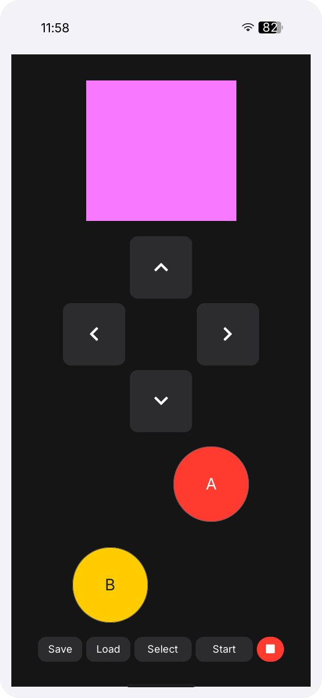

# LILYGO UI NES

[English](README.md) | **简体中文**

LILYGO UI NES 是面向 LILYGO UI 的 NES 模拟器应用，基于 C++17、
[LILYGO UI AppKit](https://github.com/LILYGO-UI/cm0-appkit)、LVGL 9.5 和
FCEUmm 构建。应用扫描用户提供的 `.nes` 文件，读取 iNES 元数据，并在独立线程中运行游戏。

FCEUmm 是唯一支持的核心，GLES 设备包使用 `cm0-cross-gles` 预设。
构建、安装、兼容性和运行细节见 [FCEUmm 核心说明](docs/05-fceumm.md)。

项目提供 CM0 ARM64 Linux 设备构建，以及用于开发和测试的 SDL2 桌面模拟器。
游戏运行使用本地 ROM，无需联网。

## 预览

<p>
  
</p>

预览显示渲染测试生成的最小 NROM 程序。本项目不附带商业游戏 ROM；
请仅使用你有权运行的 ROM 文件。

## 功能

- **本地游戏库：** 扫描 `.nes` 文件，显示名称、Mapper、PRG/CHR 容量、电视制式、镜像方式和文件大小。
- **NES 模拟：** 使用 FCEUmm 核心，以 RGB565 格式显示原生 `256 x 240` 游戏画面。
- **保存进度：** 游戏页提供 Save / Load 即时存档与读取，每个 ROM 保留一份手动即时存档；即时存档和自动电池存档统一保存在 `$HOME/nes/states`。
- **触屏控制：** 提供方向键、A、B、Select、Start 和停止按钮；Linux 设备支持直接读取多点触控，实现方向与动作组合。
- **P1 键盘映射：** W/S/A/D 控制方向，K/J 控制 A/B，I/U 触发 A/B 连发，1/2 控制开始/选择；在 ROM 库设置页点击动作行后按下新键即可修改，重复按键会被拒绝，暂不支持 P2。
- **iOS 风格界面：** 浅灰底色、白色圆角容器与蓝色操作；横竖屏均采用全宽单列 ROM 列表，Add ROM 位于列表最后一项并随列表滚动，列表下方固定工具栏提供刷新、设置和帮助，游戏画面和控件按可用空间调整。
- **游戏音频：** 桌面模拟器通过 SDL2、Linux 设备通过 `aplay` 输出 48 kHz 单声道音频。
- **游戏库管理：** 浏览文件系统并将 ROM 导入 `$HOME/nes/rom`，手动刷新目录，通过左滑显示的删除按钮移除 ROM 文件。

ROM 头部校验通过并不代表游戏一定兼容；支持情况取决于 FCEUmm 和具体 ROM。
游戏运行时支持 P1 键盘映射：W/S/A/D 控制方向，K/J 控制 A/B，I/U 分别触发 A/B 连发，1/2 控制开始/选择。P2 键盘映射暂不支持。格式、兼容性和存档说明见
[ROM 与运行指南](docs/02-roms-and-runtime.md)（英文）。

## 开始游戏

1. 启动应用，点击 ROM 列表最后一项 **Add ROM**，浏览并选择未压缩的 `.nes` 文件；点击底部工具栏中的设置按钮进入 P1 按键映射设置，点击动作行后按下新键即可修改。
2. 应用在启动和刷新游戏库时自动创建缺失的 `$HOME/nes/rom` 目录；导入将文件复制到该目录并保留源文件，随后自动刷新游戏库。
   也可以直接将文件放入该目录后点击刷新；`HOME=/root` 时目录为 `/root/nes/rom`。
3. 点击游戏条目启动，使用屏幕上的方向键、A、B、Select 和 Start 操作。
4. 点击游戏页与 Select / Start 同一行的 **Save** 保存当前进度，点击 **Load** 恢复；再次保存会覆盖该游戏的上一份即时存档。顶部状态条会显示完成或失败结果，处理过程中 Save / Load 暂不可用。
5. 点击停止按钮（Stop）关闭当前游戏并返回游戏库；支持电池存档的游戏会自动写出电池 RAM。

点击底部工具栏中的帮助按钮，可查看当前用户实际的完整 ROM 和存档目录路径、导入和手动复制后刷新、
点击启动、左滑删除、按键映射与游戏控制说明。帮助内容可独立滚动，点击 Back 返回游戏库。
游戏库主体直接显示列表，不显示摘要面板或 ROM 数量；无 ROM 时列表中仅保留 **Add ROM**。
主页面不显示状态信息；发生错误时立即弹窗显示原因，5 秒后自动关闭。

游戏库只使用 `$HOME/nes/rom`，扫描不递归进入子目录，最多收录 128 个文件。
`HOME` 必须是非空绝对路径，未设置或不合法时提示错误，不回退到其他目录。
导入时校验 iNES 头，不覆盖同名文件；目录已有 128 个 `.nes` 文件时拒绝导入并提示游戏库已满。
导入失败时保留文件选择器，并通过错误弹窗提示。
包括 `$HOME/nes` 在内的旧目录中的 ROM 不会自动迁移，可通过 **Add ROM** 导入，或手动移入
`$HOME/nes/rom` 后刷新；导入只复制 ROM，不会一并导入存档。
例如 `game.nes` 的即时存档为 `$HOME/nes/states/game.nes.state`，电池存档为
`$HOME/nes/states/game.nes.sav`。旧版的 `$HOME/nes/game.sav` 可在停止游戏后复制为上述电池存档文件。
目录、导入和存档说明见 [ROM 与运行指南](docs/02-roms-and-runtime.md)（英文）。

按键映射会保存到 `$XDG_CONFIG_HOME/lilygo-ui-nes/keymap.conf`；未设置
`XDG_CONFIG_HOME` 时使用 `$HOME/.config/lilygo-ui-nes/keymap.conf`。应用启动时读取该文件，
删除文件即可恢复默认映射。

左滑游戏条目可显示删除按钮，右滑可收起。**点击删除会立即从磁盘移除实际 ROM 文件，
没有确认对话框，也不会移入回收站。** `$HOME/nes/states` 中对应的 `.sav` 和 `.state` 文件会保留。

## 开发环境搭建

项目标识、版本和软件包元数据由 [`lpm.toml`](lpm.toml) 提供。
[`CMakePresets.json`](CMakePresets.json) 定义了 LPM 使用的 `host-simulator` 和 `cm0-cross-gles` 配置。
所有项目命令均在仓库根目录执行。

### 获取源码

```sh
git clone --recurse-submodules https://github.com/LILYGO-UI/lilygo-ui-nes.git
cd lilygo-ui-nes
```

已有仓库可使用以下命令初始化锁定版本的 AppKit 和 FCEUmm 子模块：

```sh
git submodule update --init --recursive
```

项目直接使用 `third_party/cm0-appkit`，模拟器无需单独安装 AppKit。
默认使用其中附带的 LVGL 9.5.0 源码归档，项目提供的所有构建预设均禁用了 LVGL 网络下载。
`third_party/fceumm` 是 Git 子模块，包含完整的
[FCEUmm 上游仓库](https://github.com/libretro/libretro-fceumm.git)，使用本项目锁定的提交版本，
无需单独安装 RetroArch。拉取项目更新后，再执行上述子模块更新命令，使两个依赖保持在项目记录的版本。

### 主机依赖

需要 CMake 3.21 或更高版本（包含 CTest 和 CPack）、Python 3.11 或更高版本，
以及支持 C++17 的 C/C++ 编译器。预设使用 Unix Makefiles；
AppKit 还需要 `patch` 来应用附带的 LVGL 补丁。
SDL2 提供主机显示和音频，FreeType 负责字体渲染。

#### Debian 12 / Ubuntu 24.04 或更高版本

```sh
sudo apt update
sudo apt install build-essential cmake git pkg-config patch libsdl2-dev \
  libfreetype6-dev ca-certificates python3 python3-venv python3-pip
```

较旧发行版需要先将 CMake 和 Python 升级到上述最低版本。

#### macOS

按需安装 Xcode Command Line Tools，并通过 [Homebrew](https://brew.sh/) 安装依赖。
完成 Homebrew 的 Shell 配置，确保 `brew` 及其安装的工具位于 `PATH` 中：

```sh
xcode-select --install
brew install git cmake pkg-config patch sdl2 freetype python
```

#### LPM

CMake 在配置阶段调用 `lpm metadata --format cmake`。
使用 Python 3.11 或更高版本，在项目虚拟环境中安装 LPM：

```sh
python3 -m venv .venv
. .venv/bin/activate
python -m pip install "git+https://github.com/LILYGO-UI/lpm.git"
lpm --version
```

每次打开新终端后，先执行 `. .venv/bin/activate` 再使用 `lpm`。
CMake 会同时搜索 `.venv/bin` 和 `PATH`。
如需指定其他位置的 LPM，可在配置时传入 `-DLPM_EXECUTABLE=/absolute/path/to/lpm`。

构建前检查主机环境：

```sh
cmake --version
python --version
pkg-config --modversion sdl2 freetype2
lpm metadata --format cmake
```

### 设备交叉编译器

仅构建桌面模拟器时可跳过此步骤。设备构建需要在开发机上单独安装 AArch64 Linux 交叉编译器。

**Debian / Ubuntu：**

```sh
sudo apt install gcc-aarch64-linux-gnu g++-aarch64-linux-gnu
```

**Apple Silicon macOS：**

```sh
brew install aarch64-unknown-linux-gnu
```

BSP 工具链要求 `PATH` 中存在以下名称的可执行文件：

```sh
aarch64-linux-gnu-gcc --version
aarch64-linux-gnu-g++ --version
```

SDK 对主机和编译器的要求详见 [CM0BspBuilder](https://github.com/LILYGO-UI/CM0BspBuilder)。
BSP 提供目标平台的头文件和库，但不会安装开发机所需的交叉编译器。

## 构建与测试

完成环境搭建后，在仓库根目录使用 LPM。
它会从 `lpm.toml` 读取构建预设和打包输出目录。

### 桌面模拟器

```sh
lpm start --foreground
```

此命令会配置、构建模拟器，然后以前台模式启动。
如需复用已有构建产物，执行 `lpm start --no-build --foreground`。
Debug 构建启用测试，产物位于 `build/host-simulator`。
运行应用需要图形桌面会话；主机音频使用系统默认输出设备，包括 macOS。
鼠标只能提供单点输入，同时按下触控组合需要 Linux 多点触控输入支持。

### 测试

配置、构建主机模拟器并运行全部测试：

```sh
lpm test
```

| 测试 | 覆盖内容 |
| --- | --- |
| `nes-core` | 目录扫描、导入校验、iNES 元数据、CRC32、排序和 ROM 删除 |
| `nes-audio` | SDL 音频生命周期、样本时序、不可用输出设备和 PCM 录制 |
| `nes-view-model` | 游戏库状态、无效 ROM、导入和运行时文件操作保护 |
| `nes-render-portrait` | `568 x 1232` 下的模拟器、触控组合、游戏库和删除交互 |
| `nes-render-landscape` | `1232 x 568` 下的模拟器、触控组合、游戏库和删除交互 |

渲染测试会自行生成最小 NROM 程序并启动模拟器，覆盖文件浏览和导入、固定工具栏、帮助页和设置页，无需商业游戏 ROM。
音频和渲染测试使用虚拟音频后端，无需扬声器。
截图输出到 `build/host-simulator`：

- `nes-portrait.ppm`、`nes-landscape.ppm`：运行中的游戏画面；
- `nes-portrait-library.ppm`、`nes-landscape-library.ppm`：游戏库；
- `nes-portrait-library-end.ppm`、`nes-landscape-library-end.ppm`：ROM 列表末尾的 Add ROM；
- `nes-portrait-browser.ppm`、`nes-landscape-browser.ppm`：ROM 文件选择器；
- `nes-portrait-delete.ppm`、`nes-landscape-delete.ppm`：左滑删除操作；
- `nes-portrait-help.ppm`、`nes-landscape-help.ppm`：帮助页；
- `nes-portrait-settings.ppm`、`nes-landscape-settings.ppm`：按键映射设置；
- `nes-portrait-error.ppm`、`nes-landscape-error.ppm`：错误弹窗；
- `nes-portrait-empty.ppm`、`nes-landscape-empty.ppm`：空游戏库。

修改 UI 后应检查横竖屏的十八张渲染产物；断言通过并不能验证视觉布局。
UI 验收要求见 [UI 开发规范](docs/01-user-interface.md)。

### CM0 设备构建

`lpm pack` 默认使用 `cm0-cross-gles` 预设，启用 FCEUmm 和 GLES 渲染。
它会自动补齐交叉编译用的 EGL/GLES/GBM 依赖，并让 GPU 缩放原生 NES 纹理。
兼容性见 [FCEUmm 核心说明](docs/05-fceumm.md)，驱动确认见
[GPU 渲染说明](docs/03-gpu-rendering.md)。显式选择 `cm0-cross` 预设仍可构建软件渲染版。

设备预设面向 AArch64 架构的 CM0 Raspberry Pi OS，使用 Release 构建，
禁用主机测试，并将安装前缀设为 `/usr`。交叉编译并生成 Debian 软件包：

```sh
lpm pack
```

首次执行 `lpm pack`（或 `cmake --preset cm0-cross-gles`）时，
[工具链包装脚本](cmake/cm0-bsp-toolchain.cmake)会下载 CM0 BSP `0.1.0`，
校验锁定的 SHA-256，并将 sysroot 解压到 `.cache/cm0-bsp/0.1.0/sysroot`。
首次下载需要访问 GitHub，后续配置会复用缓存。
如需修改缓存位置，可在配置时传入 `-DCM0_BSP_CACHE_DIR=/absolute/path/to/cache`。
无需在相邻目录克隆 CM0BspBuilder。

交叉编译需要 SDK sysroot 中的目标平台库和头文件，包括 FreeType 和 DRM。
主机库不能替代缺失的目标平台依赖。

CPack 将 ARM64 `.deb` 输出到 `dist/`。软件包安装可执行文件、启动器条目及图标、
桌面条目、AppStream 元数据和许可声明。目标系统需要提供 `libc6`、`libstdc++6`、
`libdrm2`、`libfreetype6`、`alsa-utils`、`libegl1`、`libgles2`、`libgbm1`、
`libegl-mesa0`、`libgl1-mesa-dri` 和 `lilygo-ui-appkit-dev >= 0.1.0`。
AppKit 在设备上提供共享运行时字体，`alsa-utils` 提供音频输出使用的 `aplay`。

将生成的 `.deb` 复制到 CM0 设备后，在设备上的文件所在目录执行：

```sh
sudo apt install --reinstall ./lilygo-ui-nes_0.1.0_arm64-gles.deb
```

文件名随版本变化，请使用 `dist/` 中实际生成的名称。
将 ROM 放入启动用户的 `$HOME/nes/rom`（以 root 运行时为 `/root/nes/rom`），
然后从 LILYGO UI Launcher 启动 `NES`。设备使用 48 kHz 音频输出；
格式、编解码器时钟与排障步骤见[音频说明](docs/02-roms-and-runtime.md#audio)（英文）。

<details>
<summary>底层 CMake 命令</summary>

LPM 封装了以下步骤。调试构建配置时也可以直接执行这些命令，但读取项目元数据仍需要 LPM。

主机构建与测试：

```sh
cmake --preset host-simulator
cmake --build --preset host-simulator --parallel
ctest --preset host-simulator
```

设备构建与打包：

```sh
cmake --preset cm0-cross-gles
cmake --build --preset cm0-cross-gles --parallel
cpack --config build/cm0-cross-gles/CPackConfig.cmake -B dist
```

</details>

### 常见问题

| 现象 | 处理方法 |
| --- | --- |
| `lpm is required to read project metadata` | 在 `.venv` 中安装 LPM，将其加入 `PATH`，或设置 `LPM_EXECUTABLE`。 |
| 找不到 `LilyGoUI`、附带的 LVGL 或 FCEUmm 源码 | 执行 `git submodule update --init --recursive`，初始化锁定版本的子模块。 |
| 缺少 SDL2 或 FreeType | 安装主机开发依赖；交叉编译时检查目标 sysroot。 |
| 找不到 Homebrew 库 | 使用 `cmake --preset host-simulator -DCMAKE_PREFIX_PATH="$(brew --prefix)"` 配置。 |
| BSP 下载失败 | 检查 GitHub Releases 访问情况和可用磁盘空间，然后重新配置。 |
| 游戏库为空 | 检查运行用户、ROM 搜索目录、文件读取权限和 `.nes` 扩展名，然后刷新；扫描不递归，最多收录 128 个文件。 |
| `Invalid iNES ROM` 或游戏无法运行 | 检查文件是否为未压缩 iNES ROM；头部校验通过后仍需确认文件完整性和 Mapper 兼容性。 |
| 无法同时按住方向与 A/B | 检查 `NES_TOUCH_DEVICE`、输入节点权限和多点触控支持；桌面鼠标和普通指针回退只提供单点控制。 |
| 没有声音 | 主机检查系统输出、音量和 `SDL_AUDIODRIVER`；设备检查 `alsa-utils`、ALSA 默认设备及混音器，详见[音频说明](docs/02-roms-and-runtime.md#audio)。 |

## 文档

| 指南 | 内容 |
| --- | --- |
| [ROM 与运行指南](docs/02-roms-and-runtime.md)（英文） | ROM 搜索路径、兼容性、控制、环境变量、存档和音频排障 |
| [架构概览](docs/00-overview.md) | 模块边界、模拟器线程、画面和输入数据流、生命周期 |
| [UI 开发规范](docs/01-user-interface.md) | 布局、字体、所有权和 UI 验证要求 |

## 致谢与许可

应用专用代码使用 [MIT 许可](LICENSE)。界面使用
[LILYGO UI AppKit](https://github.com/LILYGO-UI/cm0-appkit) 和 [LVGL](https://lvgl.io/)。

启动器图标来自
[T-Display-K230 参考实现](https://github.com/Xinyuan-LilyGO/T-Display-K230/tree/main/k230_launcher)。
共享字体保留各自的
[许可声明](third_party/cm0-appkit/assets/fonts/licenses/NOTICE.md)。

FCEUmm 使用 [GPL-2.0-or-later 许可](third_party/fceumm/Copying)并保留各源文件声明，来源与许可记录见
[FCEUmm 来源说明](third_party/FCEUMM_ORIGIN.md)。
Debian 软件包包含应用、FCEUmm 和共享字体的许可声明；分发时请遵守各自的许可要求。
